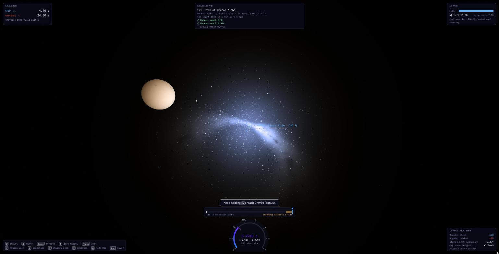
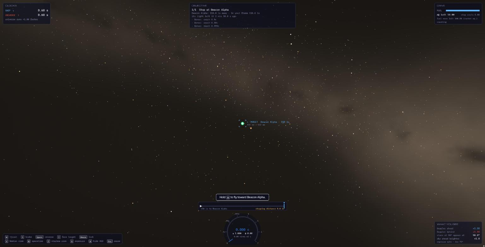
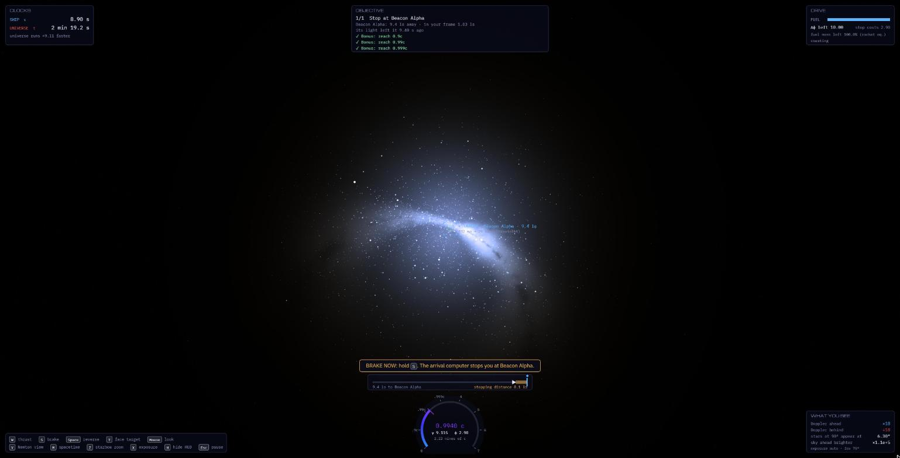
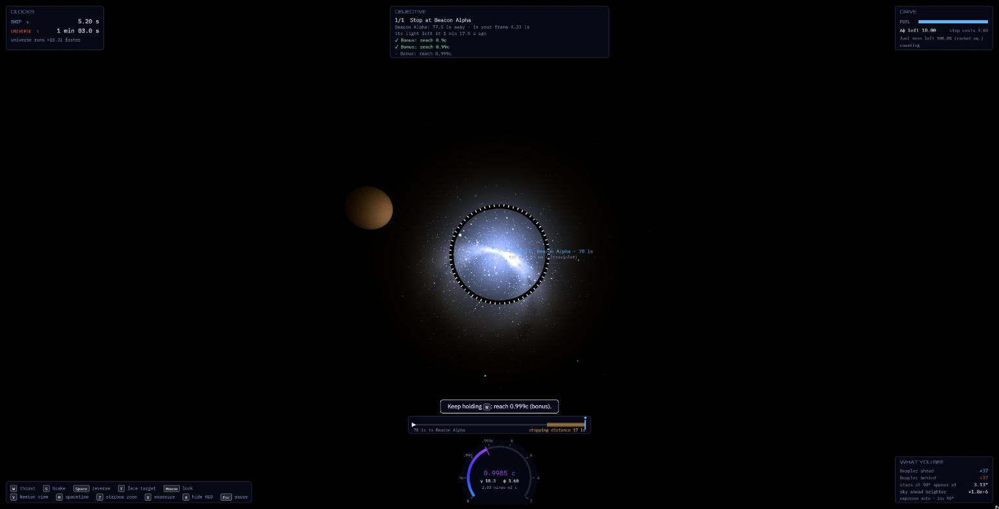
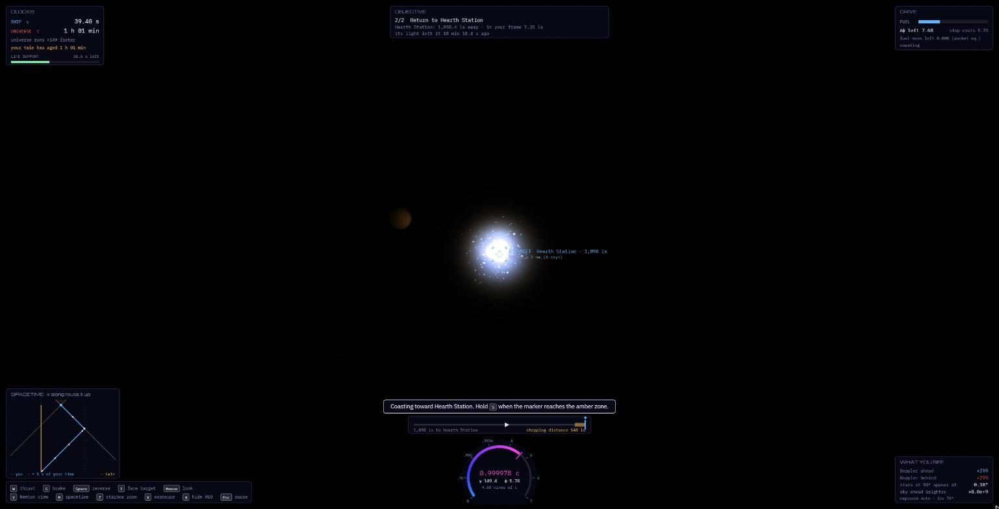
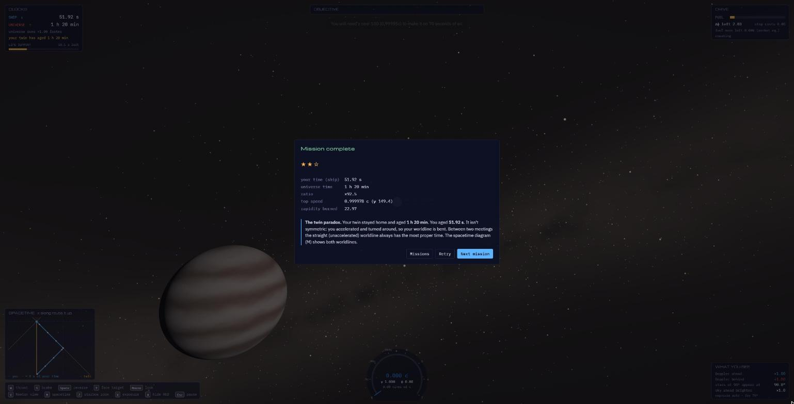
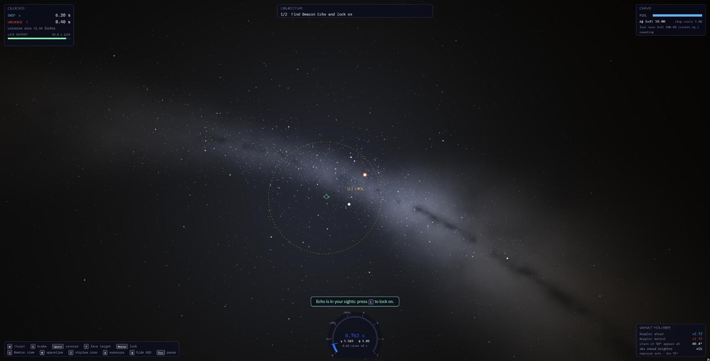
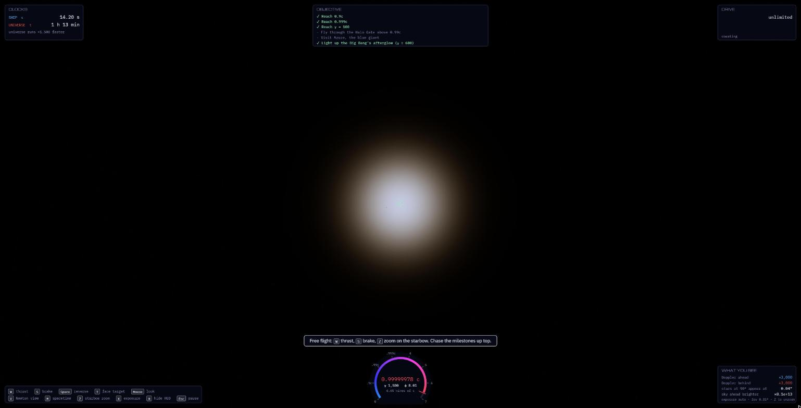
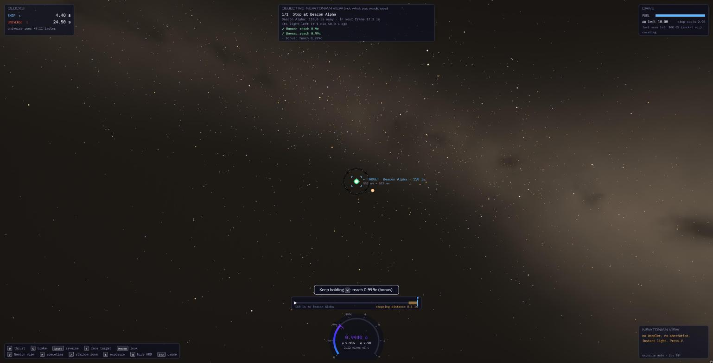

# Proper Time

**Fly a spaceship at 0.9999c and see what special relativity really looks like.**

▶ **[Play in your browser](https://krishnashub.github.io/relativity-games/proper-time/)**: keyboard and mouse, a recent desktop browser with WebGL 2. No install.



You pilot a relativistic courier from the cockpit. Your drive can take you to within a whisker of the speed of light, and every frame is computed from Einstein's special relativity:
- The sky crowds forward into a "starbow" and turns blue ahead and red behind.
- A beacon's colour shifts as you change speed.
- Things you've just flown past still appear in front of you.
- At the top speeds, the 2.7 K glow left over from the Big Bang blueshifts into visible light ahead.

Meanwhile two clocks run side by side: yours, and the universe's. A one-minute trip for you can be an hour and a half for everyone you left behind.

---

## How to play

Each mission gives you a target. The **coach line** above the speed dial always tells you what to do next, and the **approach bar** shows how close you are against how far you need to stop.

| Key | What it does |
|---|---|
| <kbd>W</kbd> | Thrust where you're facing. Hold <kbd>Shift</kbd> for fine thrust. |
| <kbd>S</kbd> | Brake against your motion, whichever way you face. Near the target the **arrival computer** eases the burn so you stop right at it. |
| <kbd>Space</kbd> | Reverse thrust: full power backwards from where you're facing. |
| <kbd>T</kbd> | Turn to face the target. <kbd>F</kbd> faces where you're going; <kbd>R</kbd> looks behind. |
| Mouse / arrow keys | Look around and turn. <kbd>Q</kbd> <kbd>E</kbd> roll. The wheel zooms. Click to capture the mouse, or drag. |
| <kbd>V</kbd> | Switch between the relativistic view and a Newtonian one (no relativity) to compare. |
| <kbd>M</kbd> | Spacetime diagram: your worldline, your light cone and your line of "now". |
| <kbd>Z</kbd> | Starbow zoom: narrow the view onto the cone the whole sky has been squeezed into. |
| <kbd>X</kbd> | Lock exposure, to see raw brightness changes. <kbd>H</kbd> hides the HUD. <kbd>Esc</kbd> pauses. |
| <kbd>L</kbd> | Lock on to a beacon (in Invisible Light). |



### The cockpit

- **Speed dial** (bottom centre): counts *nines of c*: 0.9, 0.99, 0.999 and on up to seven nines. It shades from blue to red, with γ and rapidity φ underneath.
- **Clocks** (top left): your ship time τ and the universe's time t, and how many times faster the universe is ageing.
- **Drive** (top right): fuel as rapidity left (Δφ), what stopping will cost, and the rocket equation's grim fuel-mass fraction.
- **Objective** (top centre): the goal, the target's distance in the universe frame and in yours, and how long ago the light you are seeing left it.
- **What you see** (bottom right): the Doppler factor ahead and behind, where stars at 90° appear, and how much brighter the sky ahead is.



If you're in the amber zone and not braking, the approach bar wobbles. If you're too fast to stop in time, it turns red. If you fly past the target, the coach tells you how to get back.

---

## Missions

### 1. First Light
Learn the drive. Fly to Beacon Alpha, 150 light-seconds ahead, and stop there. The bonus goals are 0.9c, 0.99c and 0.999c. On the way you fly through the Halo Gate. Look ahead just after you pass it:



The gate is 2.5 light-seconds *behind* you, yet aberration bends its light so it rings the sky ahead. Its lamps are even blueshifted: at γ = 18, something 147° behind you still has a Doppler factor of about 2.9.

### 2. Twin Clocks
Deliver a package to Kepler Relay, 2,400 light-seconds away, and come home, on **70 seconds** of life support. Light alone needs 80 minutes for the round trip, so you need γ above about 100. In your frame Kepler is only a few light-seconds away (length contraction), and its blue beacon blueshifts right out of sight into X-rays.





That's the twin paradox, and it isn't symmetric: you accelerated and turned around, so your worldline is bent. Between two meetings, the straight worldline always has the most proper time.

### 3. Invisible Light
Beacon Echo transmits at 1550 nm, infrared and invisible. Fly toward its search cone fast enough and the Doppler shift brings it into the visible band, between a factor of about 2.1 and 4.6. Fly too fast and it shifts past violet and vanishes again. Meanwhile the red buoy you were steering by has slipped into ultraviolet. Lock on, then stop at Echo, watching it fade back to infrared as you slow down.



### 4. Free Flight
Unlimited fuel and a list of milestones. The last one is pushing past γ = 600 until the **cosmic microwave background** (the Big Bang's afterglow, at 2.7 K) is blueshifted ×3,000 into a white-hot glow ahead:



---

## The physics

Press <kbd>V</kbd> at any moment to see what a Newtonian observer would draw. Here is the same instant as the starbow at the top:



### What is exact
- **Rapidity drive.** Thrust adds rapidity φ, not speed. β = tanh φ and γ = cosh φ, so speed creeps toward c and never gets there. Each extra nine of c costs the same 1.15 of rapidity.
- **Time dilation.** 1 s of play is 1 s of your proper time; the universe's clock runs γ times faster.
- **Length contraction.** Distances along your motion shrink by γ in your frame. That is why a 2,400 light-second trip can take you 20 seconds.
- **Aberration.** Light reaching you is tilted toward your direction of travel: tan(θ′/2) = e<sup>−φ</sup> tan(θ/2). This is computed in the half-angle form so it stays exact as β → 1.
- **Doppler shift.** D = γ(1 + β cos θ). Stars, the galaxy's light and the CMB are blackbodies, and a blackbody at T looks like one at D·T. Colours come from the Planck spectrum integrated against the CIE 1931 colour-matching functions.
- **Beaming.** Point sources get D² brighter; sky surface brightness goes up by D⁴.
- **Light delay.** Beacons blink, and planets spin, by their own clocks as seen with light-travel delay. A clock you approach runs fast; one you leave runs slow.
- **Shapes.** Every vertex of every planet, star and ring is drawn where its light appears: direction aberrated, distance multiplied by D. That gives Terrell rotation and the "passed things appear ahead" effect for free.
- **Rocket equation.** A perfect photon rocket gains Δφ = ln(m₀/m₁).

### What is tuned so it plays
- **Space is compressed.** Stars are light-seconds apart instead of light-years, so trips take seconds. Relativity works the same at any scale.
- **Inertial dampers.** Full thrust is about 30 million g.
- **A perfect antimatter drive**, with a governor at φ = 10 (γ ≈ 11,000).
- **Brightness is compressed.** Nearby stars and planets are drawn about 10¹⁰ times dimmer than reality so they can share the screen with the starfield, and exposure adapts like an eye. Colour shifts and brightness *changes* stay exact.
- **The arrival computer** is a gameplay aid: it throttles your braking burn.
- **Small things:** planet surface colours are tinted after the Doppler shift instead of being computed by wavelength, and the ship's axes ignore Thomas precession.

All of this is also on the in-game **Info** screen.

---

## Under the hood

One self-contained `index.html`. The only outside requests are for Google Fonts.

- **Engine** (`<script id="engine">`, no DOM): the ship's state is its position and proper velocity w = γβ. Thrust composes boosts exactly, so speeds near c stay precise. The engine also holds the aberration and Doppler maths, a blackbody luminance-and-colour table (log T from 10^0.5 to 10^7 K), and the missions.
- **Renderer** (WebGL 2):
  - A full-screen sky shader de-aberrates every pixel and looks up the CMB and the galaxy's light at D·T.
  - 7,000 catalogue stars are aberrated and shifted in a vertex shader.
  - Bodies are fine meshes whose vertices are moved to where their light appears.
  - Everything renders into a half-float HDR buffer and is tone-mapped.
- **HUD**: a 2-D canvas over the 3-D view.

### Run locally
Open `index.html` directly, or serve the folder (for example `python -m http.server`) and visit `/proper-time/`. Add `?debug` to the URL to expose `window.PT` for driving flights from the console.

### Tests
```
node tests/verify-physics.js   # the relativity against independent formulas (Lorentz transforms, Doppler, rocket equation, colours)
node tests/verify-levels.js    # an autopilot flies every mission and reports the margins
```

---

## Status

This is a playable prototype. The plan is to find what's fun here, then build a first-person version in Unreal Engine. Next on the list: black holes (gravitational time dilation as a "skip ahead" tool, lensing, tides), simultaneity puzzles, and eventually wormholes. See [`../DESIGN.md`](../DESIGN.md) and [`../TODO.md`](../TODO.md).
